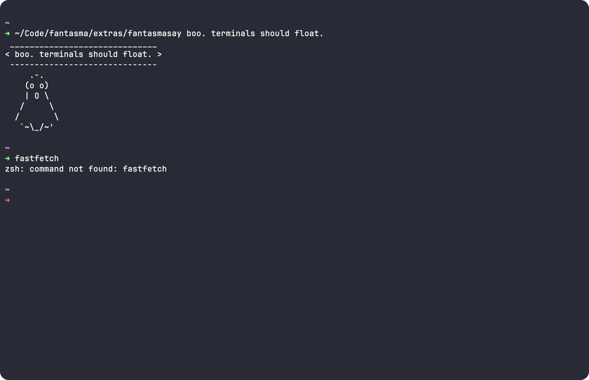
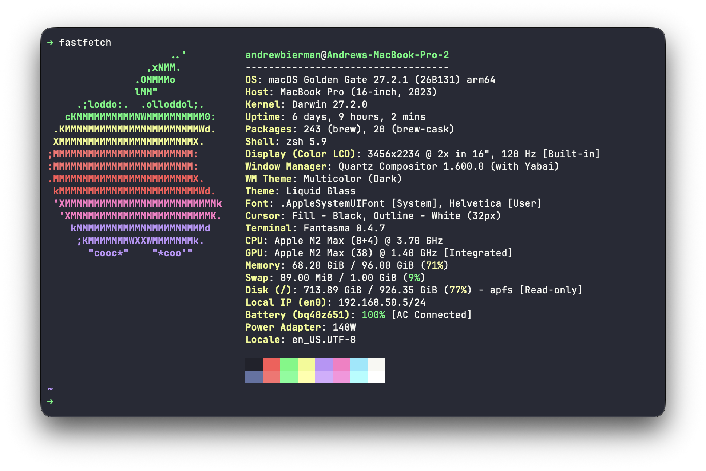

# Fantasma

<p align="center">
  
</p>

A macOS overlay terminal that recreates foot's quick-terminal UX: a hotkey
summons a floating, rounded, chrome-less terminal that takes keyboard focus
instantly; clicking away hides it, and the shell inside keeps running.
Summon it again and everything — scrollback, running jobs, working
directory — is still there. It also opens normal, tiled terminal windows
for everyday use.

<p align="center">
  
  
</p>

Built on [libghostty](https://github.com/Lakr233/libghostty-spm)
(Ghostty's terminal engine, packaged for Apple platforms). Fantasma is not
a terminal emulator and not a full terminal app: two window modes, no tabs.

## Roadmap

Shipped:

- [x] Float summon/dismiss with preserved shell (foot's flow)
- [x] Rounded corners, chrome-less, no Dock icon
- [x] Clear-on-open vs persistent shell (config)
- [x] Normal tiled window mode alongside the float
- [x] Theme, font size, padding, float size/position via config
- [x] Reads your existing Ghostty config (`theme`, `font-size`, `window-padding-x`, `copy-on-select`, `font-family`)
- [x] Copy on select
- [x] Cmd+drag move, edge/corner resize, title-bar toggle for normal windows
- [x] App icon, yabai title-scoped exemption
- [x] Homebrew tap (`brew install --cask andrew-bierman/tap/fantasma`)

Planned:

- [ ] Scrollback find bar (⌘F, via Ghostty search bindings)
- [ ] Font zoom (⌘+/⌘−/⌘0) and font weight/line-height config
- [ ] Busy-state window titles (foreground command basename)
- [ ] cwd-aware summon (OSC 7: open where the frontmost window is)
- [ ] Bell → notification, URL opening + foot-style hints mode
- [ ] Light/dark appearance pairs, config reload
- [ ] In-app global hotkey (drop the Tinycast dependency)

Foot-parity gaps we intend to close: URL launching with OSC 8 hints,
copy-on-select to the primary selection, and SIGHUP-style config reload.
Foot's server/client spawn model is noted but likely never — libghostty
surfaces already start fast.

## Install

Build from source:

```bash
git clone https://github.com/andrew-bierman/fantasma && cd fantasma
scripts/install.sh        # build + install to ~/Applications + launch
```

Or Homebrew (Apple silicon, unnotarized build — trust-the-cask flow):

```bash
brew tap andrew-bierman/tap
brew install --cask andrew-bierman/tap/fantasma
```

The first resolve downloads a ≈161 MB `GhosttyKit.xcframework`; later builds
are quick and cached.

Requires macOS 14+, Swift tools 6.2 (Xcode 26+ toolchain).

## Using it

**Float (quick-launch):** `open -a Fantasma` (or `open /path/to/Fantasma.app`)
shows the overlay, focused and typing-ready. Running the same command again
hides it; once hidden, it shows again — bind that toggle to a hotkey launcher
(Tinycast command: `open -a Fantasma`). Click away or Cmd+W and the overlay
hides. Cmd+Q quits the app.

**Normal windows:** `Fantasma.app/Contents/MacOS/Fantasma --new-window`
(requires Fantasma to be running) opens a normal titled terminal window that
your tiling manager treats like any other app. Cmd+W or the close button
closes that window and ends its shell.

**Window manipulation:** drag the outer 8px edges or corners to resize
(minimum 320×180); hold **Cmd and drag anywhere** to move the overlay.

**Shell lifecycle:** with the default config, dismissing the float ends its
shell — every summon is fresh. Exiting a shell always ends its window
(overlay quit / normal window close).

## Configuration

`~/.config/fantasma/fantasma.conf` — `key = value` lines, `#` comments,
unknown keys ignored, read once at launch. Fantasma also reads your
existing Ghostty config (`~/.config/ghostty/config`) and applies the
recognized keys (`theme`, `font-size`, `window-padding-x`, `copy-on-select`,
`font-family`) — fantasma.conf values override Ghostty's.

| Key | Default | Meaning |
|-----|---------|---------|
| `theme` | `Dracula` | Any theme name from the bundled iTerm2 catalog; unknown names fall back to the package default |
| `font_size` | `13` | Terminal font size (integer ≥ 1) |
| `font_family` | *(engine default)* | Monospace family name |
| `padding` | `8` | Window padding in points (integer ≥ 0) |
| `clear_on_open` | `true` | `true`: dismissing the float ends its shell; `false`: the shell survives hide/show with full scrollback |
| `copy_on_select` | `true` | Copy selections to the clipboard as you make them |
| `float_width` / `float_height` | `960` / `620` | Float size in points (clamped to the screen) |
| `float_x` / `float_y` | *(centered, 110pt from top)* | Float position in points from the screen's top-left |
| `normal_title_bar` | `true` | `false` hides the normal windows' title bar (full-size content, traffic lights stay) |

Example:

```ini
theme = GruvboxDark
font_size = 14
padding = 12
clear_on_open = false
float_width = 800
float_height = 500
float_x = 200
float_y = 100
```

## yabai

Exempt only the float from tiling, by title (normal windows stay tiled):

```bash
yabai -m rule --add app="^Fantasma$" title="^fantasma-float$" manage=off
```

## Tests and smoke

```bash
swift test              # config parser, geometry, window-math unit tests
scripts/smoke.sh        # AX-driven end-to-end float loop (needs Accessibility
                        # permission for the driving terminal)
```

## Name

Provisional. "Fantasma" (ghost) fits the summon-vanish overlay; "moot" was
the runner-up. A rename touches the bundle id constants in
`scripts/build-app.sh`, the app name, and the yabai rule.

## License

MIT — see [LICENSE](LICENSE).
