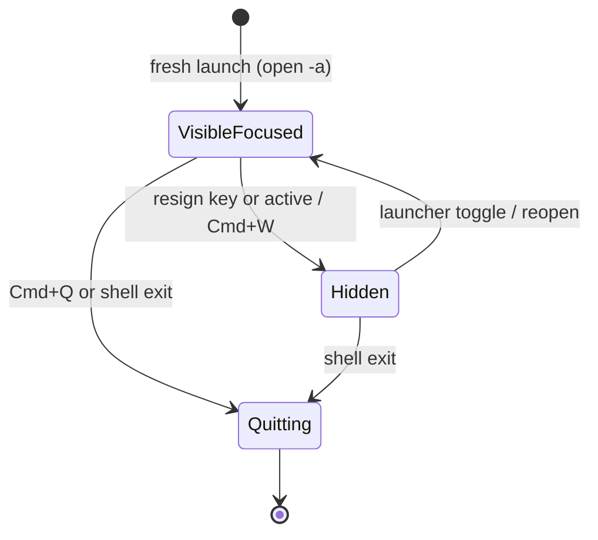
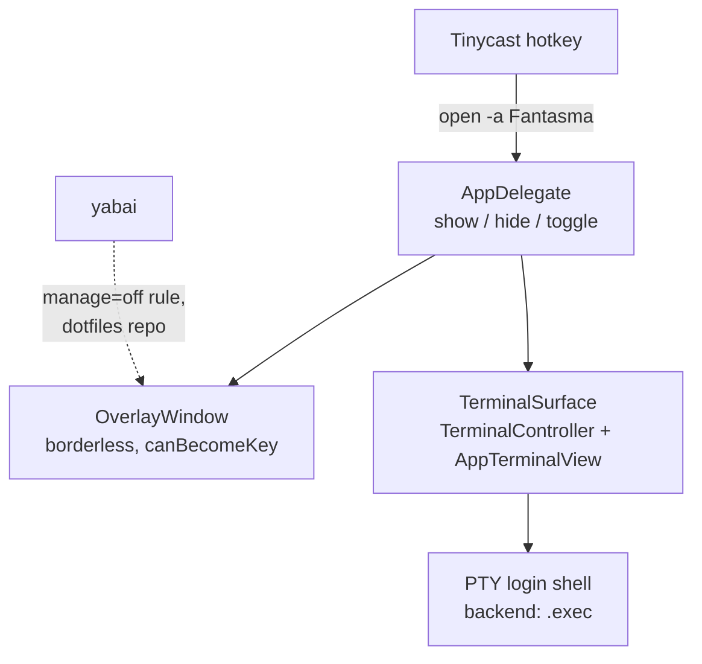

# Fantasma overlay terminal — Plan

## Goal Capsule

- **Objective:** Pressing the launcher hotkey summons a native macOS terminal overlay — floating, rounded, chrome-less — that takes keyboard focus instantly; dismissing it never disturbs the shell running inside, and no terminal window ever enters the tiling layout. Someone who has never seen the app can verify it: invoke, type, dismiss, invoke again — scrollback intact, zero clicks spent on focus.
- **Means:** A SwiftPM executable macOS app embedding libghostty through GhosttyTerminal (`libghostty-spm` ≥ 1.5.2) in a borderless key-capable window under accessory activation policy (KTD1–KTD3).
- **Authority:** R-IDs own product behavior; KTDs own mechanism within them; this plan owns neither's re-litigation.
- **Stop conditions:** If the GhosttyTerminal surface cannot be made first responder inside a borderless key window on current macOS after KTD4's retry approach, stop and report — that combination is the plan's one unproven mechanism.
- **Execution profile:** Smoke-first — the proof for window/surface behavior is the live desktop loop, not unit coverage; unit tests cover only pure logic.
- **Finishing:** `ce-work` implements and verifies locally; Andrew reviews and merges the PR. The dotfiles wiring PR lands separately after the app is proven (Scope Boundaries).

---

## Product Contract

### Summary

A single-surface macOS quick terminal: `open -a Fantasma` (bound to a Tinycast hotkey) summons a rounded borderless overlay that is focused and typing-ready; clicking away hides it; summoning again restores the same live shell. Built on packaged libghostty, with no Dock icon and no yabai tiling. Provisional name: fantasma.

### Problem Frame

foot's float/quick UX — summon, use, dismiss, state preserved — has no native macOS equivalent that also satisfies this machine's constraints: Ghostty's quick terminal cannot do rounded corners (no corner-radius option in 1.4), kitty as overlay requires ignoring the whole app and still lacks auto-hide, and tiling managers happily grab every terminal window. The user runs yabai + Tinycast and wants the overlay semantics without maintaining or entering the terminal-emulator space; libghostty 1.0's stable packaged ABI makes embedding the real Ghostty engine a library dependency rather than a project.

### Requirements

**Window and placement**

- R1. The overlay renders as one borderless window with rounded corners (≈14pt) and no title bar or traffic-light controls.
- R2. The window floats above normal windows, appears on every Space, and stays usable above full-screen apps.
- R3. Default geometry is 960×620 centered horizontally in the upper third of the main screen's visible frame; the user can resize freely down to 320×180.

**Focus and lifecycle**

- R4. Summoning the overlay — fresh launch or toggle — gives it keyboard focus; keystrokes reach the shell with no click.
- R5. When focus moves to another app or window, the overlay hides automatically.
- R6. Hiding never terminates the shell: scrollback, running jobs, and cwd survive hide/show cycles.
- R7. While the app is running, `open -a Fantasma` toggles the overlay (visible → hidden, hidden → visible); a fresh launch shows it.

**Keys**

- R8. Cmd+W hides the overlay; Cmd+Q quits the app and its shell.

**Shell and engine**

- R9. The surface runs the user's login shell through a real PTY (exec backend) with the working directory set to the home directory.
- R10. When the shell exits, the app quits.
- R11. The terminal uses a dark Dracula-family theme from GhosttyTerminal's bundled theme catalog; the window background is transparent so the rounded corners carry no square edges.

**Chrome and tiling**

- R12. The app shows no Dock icon (accessory activation policy / `LSUIElement`).
- R13. No window the app creates is ever managed (tiled) by yabai; the enforcing rule lives in the dotfiles repo, and the app keeps its app/bundle name stable so that rule can match it.

**Packaging**

- R14. `swift build -c release` produces the binary, and a bundled script assembles a launchable `.app` whose process and bundle names match the names the yabai rule and Tinycast command use.
- R15. The app runs unsandboxed (no App Sandbox entitlements) so the exec backend can spawn a shell.

### Key Decisions

- KD1. Ship the app from its own repository, not the dotfiles repo. Governs R13, R14. (session-settled: user-directed — chosen over embedding in andrew-bierman/dotfiles: dotfiles stays configuration-only, the app is a product.)
- KD2. Terminal emulation comes from packaged libghostty (GhosttyTerminal); no custom emulator, no wrapping kitty or the Ghostty app. Governs R9, R10, R11. (session-settled: user-directed — chosen over wrapping an existing terminal or writing one: the goal is foot's UX, not the terminal space.)
- KD3. The hotkey lives in Tinycast running `open -a Fantasma`; the app registers no global hotkey of its own in v1. Governs R7. (session-settled: user-directed — chosen over in-app hotkey registration: Tinycast already owns hotkeys on this machine.)
- KD4. The product is provisionally named fantasma, with moot as the alternate; naming is explicitly subject to change. Governs R13, R14. (directive carried from the user; challenge on record: fantasma kept for v1 because "moot" collides with established software names and fantasma matches the summon-vanish overlay concept — a rename touches only the bundle/process constants, the bundle script, and the yabai rule.)

### Success Criteria

- SC1. On the live desktop: invoke → run a command → Cmd+W → invoke again → the earlier output and full scrollback are on screen, nothing relaunched.
- SC2. With the overlay visible, clicking another app hides it, and anything running inside keeps running.
- SC3. A yabai-tiling desktop never gains a Fantasma tile.

### Acceptance Examples

- AE1. Covers R4, R7 — **Given** the app is not running, **When** the launcher command executes, **Then** the overlay appears focused within about a second and typed characters reach the shell.
- AE2. Covers R5, R6 — **Given** a long-running job is printing into the overlay, **When** the user clicks another app, **Then** the overlay disappears while the job keeps running, and re-summoning shows the job's continued output.
- AE3. Covers R7, R8 — **Given** the overlay is visible, **When** `open -a Fantasma` runs again, **Then** it hides; **When** Cmd+W is pressed while focused, **Then** it hides and the process persists.

### Scope Boundaries

Outside this product's identity: a general-purpose terminal. Tabs, split panes, a settings UI, config files, theme pickers, and shell-integration customization are kitty/Ghostty territory; Fantasma is a summon-and-dismiss quick terminal, foot's float mode, not a replacement terminal.

Deferred to Follow-Up Work:

- Dotfiles wiring PR in andrew-bierman/dotfiles: yabai rule `app="^Fantasma$" manage=off`, README docs, exact Tinycast command, regression tests — lands after the app is proven on the desktop.
- GitHub Actions CI: macOS runners bill at 10× minutes, against the fleet's hard Actions budget; local verification (Verification Contract) covers v1.
- Link-opening and paste-protection delegate hooks: without a hook, libghostty's macOS opener refuses text links — acceptable for v1.
- Icon, signing/notarization, and distribution (Homebrew cask).
- System-appearance (light) theme switching.

Open Questions: none blocking. The final name should be confirmed before wide distribution, but a rename is cheap and does not gate any of the work above.

---

## Planning Contract

### Key Technical Decisions

- KTD1. Engine wiring: GhosttyTerminal product of `libghostty-spm` pinned `from: "1.5.2"` (package manifests require Swift tools ≥6.0 — 2.x requires 6.2; the local toolchain is Swift 6.4.2), with `TerminalController(configSource: .none, theme:, terminalConfiguration:)`, `AppTerminalView`, `TerminalSurfaceOptions(backend: .exec, workingDirectory: home, envVars:)`, and `fitToSize()` on layout change. Instantiates KD2, cites R9, R11. (session-settled: user-approved — chosen over arach/Termini: Termini's runtime force-sets the regular activation policy, fighting the accessory overlay, and ships ambiguous view initializers; GhosttyTerminal is the production path justty uses and leaves window/app policy to the host.)
- KTD2. The window is a borderless `NSWindow` subclass whose `canBecomeKey`/`canBecomeMain` return true: plain borderless windows refuse key status, which silently drops every keystroke (proven in the prototype — `key=false` with a plain `NSWindow`, input dead). Governs R1, R4.
- KTD3. Activation ordering on every show: `NSApp.setActivationPolicy(.accessory)` **before** `NSApp.activate(ignoringOtherApps:)` and `makeKeyAndOrderFront` — flipping the policy while active resigns active immediately and re-triggers auto-hide (proven). Governs R4, R12.
- KTD4. Focus handoff is a bounded show-settle sequence: after show, request first-responder status for the surface on a retry loop with a hard cap (≈10 attempts × 50 ms) — the surface's focus binding lands only after its view mounts (prototype behavior; justty solves the same race with a pending-focus + windowDidBecomeKey pattern). The focus-loss guard covers only the settle window; a settle that never completes keeps the overlay visible and logged, and the next toggle recovers it. Reopen events are debounced (≈200 ms) so a launcher double-fire cannot toggle twice. Governs R4.
- KTD5. Hide is `orderOut` only; the surface and controller are never stopped on hide — state preservation is structural, not a save/restore feature (surfaces keep grid/scrollback/session while mounted-but-hidden, per justty's parked-tab mounting). Governs R5, R6.
- KTD6. Cmd+W/Cmd+Q via a local `NSEvent` monitor filtered to the overlay window — a borderless window has no menu bar to carry key equivalents (proven). Governs R8.
- KTD7. Entry point is explicit top-level `NSApplication` wiring (shared app, delegate, run) — `@main` on an `NSApplicationDelegate` class does not fire `applicationDidFinishLaunching` in a SwiftPM executable target (proven). Governs R14.
- KTD8. Packaging: `scripts/build-app.sh` assembles `Fantasma.app` from the release binary with an `LSUIElement` Info.plist; bundle id `com.andrewbierman.fantasma`; the stable string "Fantasma" is what the yabai rule and Tinycast command match. Governs R12, R13, R14.
- KTD9. Shell exit: `TerminalSurfaceCloseDelegate.terminalDidClose` → `NSApp.terminate` — the delegate fires regardless of overlay visibility, so a shell dying while the overlay is hidden still quits the app; re-summoning relaunches a fresh shell. Chosen over auto-restarting the shell: an exited shell is usually intentional, and silent restarts would discard the user's mental model of what died (justty treats surface close as terminal too). Governs R10.
- KTD11. Resizing needs explicit edge handling: a borderless window with `.resizable` in its styleMask gets no standard edge-resize affordance, so the window implements edge hit-testing (invisible edge zones driving frame changes) to honor R3 — verify this works in U1's smoke pass before building on it. Governs R3.
- KTD12. Summoning resolves through LaunchServices: the Tinycast-facing command is `open -a Fantasma`, which only works once the assembled bundle is registered (first `open` of the bundle path, or an install location LaunchServices scans). U1's verification therefore proves name-based resolution, and the dotfiles docs carry the bundle-path command as the pre-install fallback. Governs R7, R14.
- KTD10. Placement math lives in a pure function of the visible screen frame — centered horizontally, fixed top inset, clamped to the minimum size — the only non-trivially unit-testable logic in an AppKit-bound app. Governs R3.

### High-Level Technical Design

Overlay lifecycle:



Components and control flow:



### Output Structure

```text
fantasma/
├── Package.swift
├── Package.resolved            # generated on first resolve; the pin record (KTD1)
├── Sources/Fantasma/
│   ├── main.swift             # entry: NSApplication wiring (KTD7)
│   ├── AppDelegate.swift      # lifecycle, show/hide/toggle, key monitor
│   ├── OverlayWindow.swift    # borderless key-capable window (KTD2)
│   ├── TerminalSurface.swift  # controller + AppTerminalView exec wiring (KTD1)
│   └── OverlayGeometry.swift  # pure placement math (KTD10)
├── Tests/FantasmaTests/
│   └── OverlayGeometryTests.swift
├── scripts/
│   ├── build-app.sh           # release binary → Fantasma.app (KTD8)
│   └── smoke.sh               # AX-driven summon/focus/hide loop
├── docs/plans/                # this plan
├── README.md
└── LICENSE
```

### Assumptions

Un-validated agent bets, recorded because this run proceeded without a scoping confirmation:

- Deployment target macOS 14 (GhosttyTerminal's floor is 13; the prototype validated 14+ APIs; the user's machine is far newer).
- Placement uses `NSScreen.main` at show time; per-display targeting is accepted as v1 single-screen behavior.
- Login shell resolution: the exec backend's default with `$SHELL` fallback; no shell-integration injection beyond the package default.
- The Tinycast command string is `open -a Fantasma`, which resolves by name only after LaunchServices knows the bundle (KTD12); until the app is installed, the docs carry the bundle-path form.
- The dark theme applies unconditionally; system-appearance switching is deferred.

### Risks and Dependencies

- libghostty-spm releases weekly, but `from: "1.5.2"` only takes newer compatible versions when the resolution updates (fresh clone or `swift package update`); an existing checkout stays frozen at the version `Package.resolved` recorded (≈1.6.20261003 today, whose manifest requires Swift tools 6.0). If an update breaks the build, pin the exact last-good version instead.
- The first resolve downloads a ≈161 MB GhosttyKit XCFramework; slow first build, cached afterwards.
- First-responder handoff inside a borderless key window is proven on Termini but not yet on GhosttyTerminal itself; if focus cannot land, KTD4 is the first suspect — and per the Goal Capsule, unresolvable focus is a stop-and-report.
- Building libghostty from source (zig/Metal toolchain) is out of scope; the prebuilt XCFramework needs none of that.

### Sources and Research

- libghostty-spm README (products, exec vs inMemory backends, versioning policy) and `Example/GhosttyTerminalApp/` (`ViewController.swift`, `Entitlement.entitlements`) — the example sandboxes itself and therefore uses `.inMemory`; real `.exec` needs the unsandboxed posture R15 fixes.
- justty (`0x96f/justty`) `TerminalSession.swift` — the `TerminalController`/`AppTerminalView`/delegate wiring, shell-exit and busy-state patterns; `WindowChrome.swift` — hidden-titlebar chrome (superseded here by true borderless).
- Session prototype in the dotfiles worktree (`overlay/Sources/Overlay/main.swift`) — proven mechanics behind KTD2, KTD3, KTD4, KTD6, KTD7.
- libghostty 1.0 announcement (`mitchellh.com/writing/libghostty-1-0`) for the embedding posture.

---

## Implementation Units

### U1. Package scaffold and app skeleton

- **Goal:** The repo builds, and an empty rounded overlay window launches from an assembled bundle with no Dock icon.
- **Requirements:** R1, R3, R12, R14, R15.
- **Dependencies:** none.
- **Files:** `Package.swift`, `Sources/Fantasma/main.swift`, `Sources/Fantasma/AppDelegate.swift`, `Sources/Fantasma/OverlayWindow.swift`, `Sources/Fantasma/OverlayGeometry.swift`, `scripts/build-app.sh` (`.gitignore` exists).
- **Approach:** Swift tools 6.2 (libghostty-spm 2.x manifests require it; local toolchain is Swift 6.4.2), platform macOS 14, dependency `libghostty-spm` products `GhosttyTerminal` and `GhosttyTheme` (KTD1); explicit top-level app wiring (KTD7); `OverlayWindow` subclass (KTD2) with edge hit-testing for resizing (KTD11); placement helper (KTD10); LSUIElement bundle assembly (KTD8). Before wiring the engine, probe the window mechanics with a placeholder first-responder view — key-capability, accessory-before-activate ordering, focus handoff, edge resize — settling the plan's stop condition cheaply, without the ≈161 MB download (KTD2–KTD4, KTD11). Window content is a placeholder view until U2 swaps in the terminal.
- **Execution note:** Mostly packaging — prefer launch/runtime smoke verification over unit coverage; expect a slow first resolve (≈161 MB XCFramework). Prove the two window mechanics the prototype never exercised — edge resizing and name-based LaunchServices resolution — before U3 builds on them.
- **Test scenarios:** Test expectation: none — scaffolding and packaging only.
- **Verification:** `swift build -c release` exits 0; `scripts/build-app.sh` emits `Fantasma.app`; opening the bundle shows a borderless rounded window at the computed frame, no Dock icon, and the app stays alive; the placeholder view accepts typed keystrokes after summon with no click; dragging the window's edges resizes it down to the 320×180 floor; a second `open -a Fantasma` (by name) reaches the running instance.

### U2. Terminal surface over exec

- **Goal:** A real login shell renders and accepts typing inside the rounded overlay.
- **Requirements:** R4, R6, R9, R11.
- **Dependencies:** U1.
- **Files:** `Sources/Fantasma/TerminalSurface.swift` (new), `Sources/Fantasma/AppDelegate.swift` (hosts the surface as the window's content).
- **Approach:** KTD1 wiring; the launch command wraps the user's shell as a login shell (`-l` — the exec backend's default is not guaranteed to be a login shell, and R9 requires one; justty does the same); Dracula-family theme resolved from the bundled theme catalog at implementation time; transparent window background with layer corner-radius clipping; first-responder handoff after the window is key (KTD4); shell-exit → quit wired (KTD9, exercised in U4).
- **Test scenarios:**
  - Happy path: launch → the login shell's prompt renders on the Dracula background; `echo hi` prints `hi`.
  - Edge case: with a flood of output (`yes | head -1000`), resizing the window reflows the grid without garbled rows.
  - Integration: `pwd` at first prompt reports the home directory.
- **Verification:** keystrokes reach the shell with no prior click on the window; all four corners show background, not square terminal edges.

### U3. Overlay semantics: toggle, auto-hide, state preservation

- **Goal:** The summon/dismiss loop feels like foot's quick terminal.
- **Requirements:** R2, R4, R5, R6, R7.
- **Dependencies:** U2.
- **Files:** `Sources/Fantasma/AppDelegate.swift`, `Sources/Fantasma/OverlayWindow.swift`, `Sources/Fantasma/OverlayGeometry.swift`.
- **Approach:** KTD3 ordering on every show; reopen → toggle via `applicationShouldHandleReopen`; resign-key and resign-active → `orderOut`, guarded by a show-settled latch so the show's own activation cannot self-hide; floating level, all-Spaces, fullscreen-auxiliary collection behaviors; geometry applied at creation only (KTD5, KTD10).
- **Test scenarios:**
  - Covers AE1. Fresh launch: overlay appears focused; typed characters reach the shell with no click.
  - Covers AE2. Start a long-running job, click another app: overlay hides, job continues, re-summon shows continued output.
  - Covers AE3. Reopen while visible hides; reopen again shows.
  - Edge case: launcher double-fire in quick succession leaves the overlay sane (visible or hidden, exactly one window) — the reopen debounce absorbs it.
  - Edge case: hide during a vim session, re-summon — vim is alive in the same buffer.
  - Edge case: the display configuration changes while hidden (screen unplugged) — re-summoning either shows the overlay on the remaining screen or re-places it; never off-screen with no way to reach it.
  - Edge case: summoning from Tinycast — the launcher's own activation must not steal focus and trip auto-hide; the settle latch covers the foreground grab, and the overlay stays up.
- **Verification:** the full loop passes as a manual live-desktop pass; `scripts/smoke.sh` (delivered in U5) re-runs it as the regression gate.

### U4. Keys, quit paths, and instance sanity

- **Goal:** Keyboard lifecycle behaves like a native app despite having no menu bar.
- **Requirements:** R7, R8, R10, R12.
- **Dependencies:** U3.
- **Files:** `Sources/Fantasma/AppDelegate.swift`.
- **Approach:** KTD6 local monitor (event's window is the overlay; command+w → hide, command+q → `NSApp.terminate`); shell exit → terminate (KTD9); reopen matrix verified across not-running / running-visible / running-hidden.
- **Test scenarios:**
  - Happy path: Cmd+W hides with the process still alive; Cmd+Q quits and the process is gone.
  - Edge case: Cmd+W while another app is key — the overlay is unaffected (monitor filters by window).
  - Edge case: `exit` at the prompt quits the app; the launcher then relaunches into a fresh shell.
  - Edge case: launcher fires while running-hidden — shows the existing instance, never spawns a second.
- **Verification:** each scenario exercised via `scripts/smoke.sh` or osascript keystrokes with `pgrep` checks.

### U5. Tests and smoke harness

- **Goal:** Repeatable local verification with no CI dependency.
- **Requirements:** R3, R14; SC1–SC3.
- **Dependencies:** U1 (geometry), U3 (loop), U4 (keys).
- **Files:** `Tests/FantasmaTests/OverlayGeometryTests.swift`, `scripts/smoke.sh`, `Package.swift` (test target).
- **Approach:** XCTest over `frame(for:)` — centering, top inset, minimum-size clamp, tiny-screen clamp; `smoke.sh` orchestrates launch, AX window counts, keystrokes, and `pgrep`, exiting nonzero on the first failure.
- **Test scenarios:**
  - Geometry: a 1728×1117 visible frame yields 960×620 centered horizontally with a 110pt top inset; a screen smaller than the minimum clamps to the minimum while staying on-screen.
  - Covers AE1, AE2, AE3. The smoke script's scripted sequence passes end-to-end.
- **Verification:** `swift test` green; `scripts/smoke.sh` green.

### U6. README, LICENSE, and repo hygiene

- **Goal:** A stranger can build, run, and understand the project from the repo alone.
- **Requirements:** R14; KD4.
- **Dependencies:** U5 (documented commands match reality).
- **Files:** `README.md`, `LICENSE`.
- **Approach:** MIT license; README covers what it is (foot-style overlay on libghostty), build/run steps, the Tinycast command, the yabai rule snippet, and the provisional-name note.
- **Test scenarios:** Test expectation: none — documentation.
- **Verification:** a cold clone plus README steps produce a working overlay.

---

## Verification Contract

| Check | Command | Proves |
|---|---|---|
| Build | `swift build -c release` | Compiles and links GhosttyTerminal |
| Unit tests | `swift test` | Placement math (KTD10) and future pure logic |
| Bundle | `scripts/build-app.sh` | Launchable `.app` with `LSUIElement` (R12, R14) |
| Smoke loop | `scripts/smoke.sh` | AE1–AE3: summon, focus, hide, state, toggle, quit |
| Manual pass | live desktop | SC1–SC3, rounded corners, no Dock icon, no yabai tile — with a session-scoped `yabai -m rule --add app="^Fantasma$" manage=off` injected for the pass (the persistent rule lands in the deferred dotfiles PR) |

The smoke script's synthetic keystrokes require Accessibility permission for the driving terminal; it checks and exits with instructions when missing.

No CI in v1 (macOS runner cost — Scope Boundaries); these local gates are the merge bar for the PR.

---

## Definition of Done

- Global: every Verification Contract row green; no Dock icon in any state; SC1–SC3 hold on the live desktop; no `Fantasma` process or `/tmp` debug log left behind after testing; abandoned-attempt code from failed approaches is deleted, not left in the diff.
- Per unit: each unit's Verification line is satisfied before the next depends on it; U5's harness exists and is green before done is claimed.
